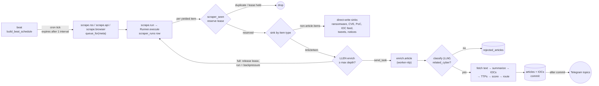
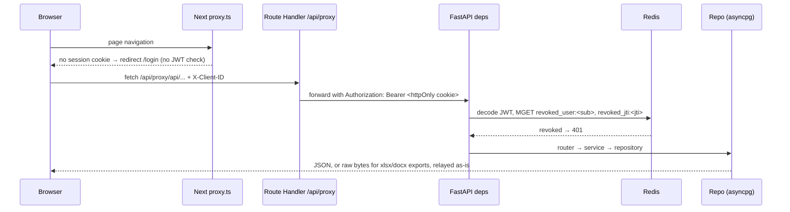
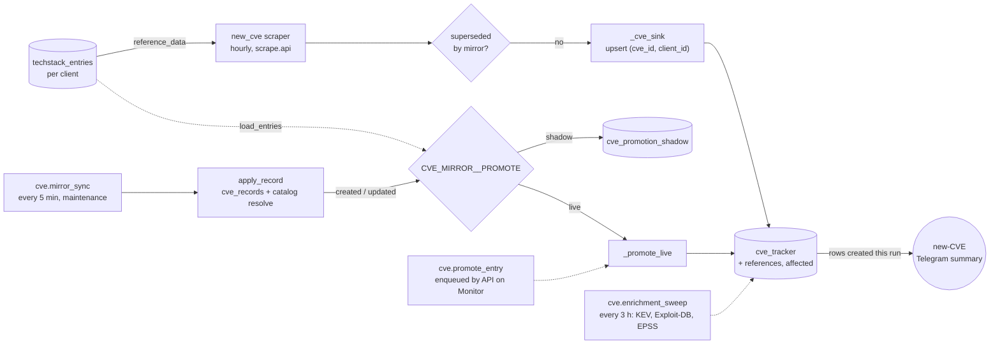

# Architecture

How Vareon Intelligence moves data from ~95 sources to the analyst's screen and to Telegram. It covers the
runtime topology, the three main data flows, who reads and writes which store, the code path to read for each
flow, and the design decisions and open risks a reviewer should know about.

Everything here was read from the code at `e44d4bc` (2026-10-10). Code references name the file and the
symbol, not line numbers, so they survive edits. When the code changes, update this file.

Related: `CLAUDE.md` (commands and conventions), `docs/CVE_TRACKER_FLOW.md` (CVE Tracker in depth),
`docs/ADDING_A_SCRAPER.md`, `docs/CI_CD.md`.

## 1. Overview

The system is a one-way pipeline glued together by **Celery on Redis**, with **Postgres** as the only durable
store.

1. **Ingest.** Scrapers (RSS, HTML, APIs, X/Twitter, GitHub) run on a cron schedule and yield typed items.
2. **Enrich.** Articles go through an NLP + LLM pipeline: classification, full text, summary, IOCs, MITRE
   ATT&CK TTPs, threat actor / country / industry scoring.
3. **Serve and alert.** FastAPI serves the data to a Next.js UI. Telegram receives routed alerts, and
   Microsoft Graph sends mail (newsletter, CVE).

Ingest is fast (seconds per run). Enrichment is slow (~10-13 s plus LLM time per article). The two halves
therefore run on different queues and worker images, with backpressure between them (section 3.1).

## 2. Components and runtime topology

### Workspace packages

| Package | Path | Role |
|---|---|---|
| `cti-core` | `packages/cti-core` | Settings, SQLAlchemy models and repositories, LLM client, IOC extractor, CVE mirror and promotion. Every other package depends on it. |
| `cti-scraper` | `packages/cti-scraper` | Scraper framework: `BaseScraper`, `ScraperMeta`, registry, `Runner`, dedup, sinks, rate limiting, CLI. |
| `cti-scrapers` | `scrapers/` | The scraper plugins: `feeds/` (one file per source) and `collectors/` (bespoke). Auto-discovered. |
| `cti-enrich` | `packages/cti-enrich` | Enrichment pipeline and its stages. The `nlp` extra (spaCy, sumy) is installed only in the `worker-nlp` image. |
| `cti-alerts` | `packages/cti-alerts` | Telegram and Microsoft Graph mail. |
| `cti-api` | `apps/api` | FastAPI: thin `routers/` → `services/` → `cti_core` repositories. |
| `cti-worker` | `apps/worker` | Celery app, tasks, beat. **Depends on `cti-api`** (section 7, note 6). |
| web | `apps/web` | Next.js 16 App Router UI. Never calls `cti-api` from the browser directly. |

### Compose services

| Service | Command / queues | Notes |
|---|---|---|
| `postgres`, `redis` | | Redis runs with AOF (`--appendonly yes`). |
| `migrate` | `alembic upgrade head` | The only process that migrates. API and workers never do. |
| `api` | uvicorn, several processes | `lifespan` bootstraps reference rows under a Postgres advisory lock. |
| `worker` | `-Q scrape.rss,scrape.api,notify,maintenance` | Light scrapers, notifications, periodic maintenance. |
| `worker-browser` | `-Q scrape.browser` | Scrapers with `runtime="browser"` (Playwright/Chromium). |
| `worker-nlp` | `-Q enrich` | Enrichment. Image includes spaCy and sumy. |
| `beat` | `python -m cti_worker.beat_main` | Singleton: holds a Redis lock (`cti:beat:lock`) and renews it. |
| `web`, `nginx` | | Next.js server and the TLS reverse proxy. |

One Celery app (`cti_worker.celery_app`) serves every worker. The `-Q` flag picks the role. Tasks use
`acks_late`.

## 3. Data flows

### 3.1 Scrape → enrich → alert



**Scheduling.** `cti_worker.beat.build_beat_schedule` runs once, at import. It reads the scraper registry and
the `scraper_config` rows, skips scrapers that are disabled or superseded (`cti_scraper.supersede.
effective_enabled`), and adds one `scrape.run` entry per scraper. The queue comes from
`cti_scraper.queues.queue_for`: `scrape.browser` for `runtime="browser"`, `scrape.api` for scrapers with a
`credential`, `scrape.rss` otherwise. Each tick expires after one schedule interval (`_tick_expiry_s`).

**A run.** `scrape.run` (`apps/worker/src/cti_worker/tasks/scrape.py`) builds a `Runner` and calls
`execute()`. The runner re-reads `scraper_config` (so disabling takes effect at once), writes a
`scraper_runs` row, resolves credentials and `reference_data`, and iterates over `scraper.fetch(ctx)`. A scraper
with no `scraper_seen` rows is "cold": only its newest `scraper.cold_start_max_items` (5) items are
dispatched and the rest are marked seen.

**Per item** (`Runner._handle_item`):

1. `DedupStore.reserve` inserts or steals a `scraper_seen` lease (`in_flight`, 15 minutes). A row that is
   `done`, or `in_flight` with a live lease, means drop.
2. `sinks.dispatch` picks the sink registered with `@sink_for(<ItemType>)`.
3. The session commits, then `DedupStore.commit` marks the key `done` with `dedup_ttl_days`, and commits again.
4. On a sink error the lease is released, so the next run retries the item.

**Article sink.** `_article_sink` does not touch Postgres. It checks `ensure_enrich_capacity` (Redis `LLEN
enrich` against `scraper.enrich_queue_max_depth`) and then `send_task("enrich.article")`. When the queue is
full it raises `BackpressureError`: the runner releases the lease and stops the run with status
`backpressure`.

**Other sinks** (ransomware victims, CVEs, PoCs, malware trends, IOC feeds, tweets, CVE mentions, notices)
write Postgres directly from the scrape worker.

**X Intel vs tweet alerts.** Two separate scraper families read X/Twitter, and only one of them feeds the X
Intel tab:

| | `monitor_x` | `tweet_alerts_1h` / `tweet_alerts_30m` |
|---|---|---|
| Accounts | the active rows of `monitored_accounts` (X Intel → Monitored Accounts) | two hardcoded lists in `collectors/tweet_alerts.py` (10 + 11 accounts) |
| Item type / sink | `TweetItem` → `tweets` (insert-only) | `NoticeItem` → Telegram, plus one `TweetItem` → `tweets` per tweet that passes `classify()` |
| Enrichment | regex scan + `classify()`; saves author, media and LLM fields | regex scan + `classify()` + topic routing; per-account filters; the same scan and LLM fields are saved with the tweet (no extra LLM call) |
| Provider | twitterapi.io (default) or X official, chosen per scraper in the Scrapers tab | same |

`tweets.source` records the scraper that stored a row first (`monitor_x`, `tweet_alerts_1h`, `tweet_alerts_30m`);
the sink is insert-only, so a tweet both families see keeps the first writer's row and `source` does not mean
"was alerted". Rows from the alert scrapers have no author name or followers when the provider is X official
(the adapter only requests `username`), and no media; the UI hides those fields. The alert scrapers also
leave a `scraper_items` row per notice (title `@user: text[:100]`, URL, accepted or not), purged after
`worker.scraper_item_retention_days` (30), plus the `scraper_seen` dedup key.

`monitor_x`, `tweet_alerts_*` and `trending_cve` all have the `provider` option (`monitor_x` gained it on
2026-10-16, after an invalid twitterapi.io key stopped it for two weeks while the alert scrapers kept running
on X official). The twitterapi.io path of `monitor_x` is unchanged (one search per account, `since_id`). On
X official it keeps the per-account loop and the `rate_limit` pause between accounts, but reads each account
through the shared adapter with a 6 h window (X official has no `since_id` in `TweetSearch`) and drops tweet
ids at or below the stored maximum before the scan and the LLM call; rows have no author name, avatar,
followers or media.

`monitor_x` resolves `since_id` per account from the highest stored `tweet_id` of its
own rows (`reference_data._resolve_tweet_last_seen_ids`: `source = 'monitor_x'`, lowercase keys because
`tweets.author_username` keeps the casing the API returns). Alert rows are excluded; otherwise a newer alert
tweet would move `since_id` past tweets the alert filters rejected.

**Enrichment** (`cti_enrich.pipeline.run_pipeline`):

1. `classify(title)`. If `related_cyber` is false, write a light `rejected_articles` row and return.
2. `fetch_text` → `summarize` → `extract_iocs` and the C2 check.
3. If `security_tech_best_practice`, skip TTPs and scoring: persist and alert on the `best_practice` topic.
4. Otherwise `extract_ttps` (normalised against the ATT&CK catalog), `score`, `routing.route`.
5. `persist` upserts `articles` by `url_hash` and writes countries, industries, threat actors, TTPs and IOCs.
   It also deletes any `rejected_articles` row for the same URL.
6. **Commit**, track CVE mentions (new articles only), then `route_alerts` sends one Telegram message per
   topic.

**Failure policy** (`apps/worker/src/cti_worker/tasks/enrich.py`). Transient errors (LLM connection, 5xx,
429 that is not quota, network, DB connection) retry up to 6 times with 30 s → 10 min backoff and jitter.
Broken JSON retries twice. On the final failure `on_failure` writes `rejected_articles` with reason
`[enrichment_failed] ...` (secrets scrubbed), unless the article was already persisted.

### 3.2 Read path: UI → API → Postgres



- `apps/web/src/proxy.ts` is an **optimistic** guard: it only checks that the `cti_session` cookie exists.
- `apps/web/src/app/api/proxy/[...path]/route.ts` is the only way client components reach the API. It reads
  the httpOnly cookie server-side, adds `Authorization: Bearer`, forwards `X-Client-ID` and the client IP
  headers, and relays the body as raw bytes.
- `cti_api.deps.get_current_user` does the real enforcement: JWT decode, Redis revocation check
  (`token_revocation.is_revoked`), and the force-password-change gate.
- **Tenancy.** `deps.effective_client_id` picks the active client from `X-Client-ID` (any value for
  superadmin; otherwise only one of the user's `client_ids`). `deps.ensure_client_access` answers 404, not
  403, for another client's object. Only routers that call these are tenant-scoped (section 7, note 4).
- Roles: `require_auth`, `require_admin` (admin or superadmin), `require_superadmin`.

### 3.3 CVE Tracker ingest

`techstack_entries` (per client) decides which CVEs reach `cve_tracker`. Two ingest paths exist:



- **Legacy path.** `new_cve` (`scrapers/src/cti_scrapers/feeds/new_cve.py`) searches NVD and Tenable per tech
  name, fetches MITRE detail per candidate, applies a relevance gate, and yields one `CveItem` per affected
  client. `_cve_sink` upserts on `(cve_id, client_id)` and collects newly created rows. `finish_run` sends one
  summary at the end of the run.
- **Mirror path.** `cve.mirror_sync` (`cti_core.cve_mirror_sync.sync_once`) takes a session-level Postgres
  advisory lock, reads the cvelistV5 delta log, keeps a cursor and a retry queue in `job_state`, and applies
  each record to `cve_records` with catalog resolution. Promotion runs in the same savepoint.
- **Modes.** `off`: mirror only. `shadow`: write `cve_promotion_shadow` to compare against `new_cve`. `live`:
  upsert `cve_tracker` and suspend `new_cve` (`supersede.superseded_by_mirror`). Rollback is the flag. Runbook:
  `docs/CVE_CATALOG_CUTOVER.md`.
- **Enrichment.** `cve.enrichment_sweep` calls `cti_api.services.cve_lookup` (CISA KEV, Exploit-DB, EPSS) and
  writes the result to every client's row for that `cve_id`.

Full detail, including ticketing and the tech matchers: `docs/CVE_TRACKER_FLOW.md`.

### 3.4 Periodic jobs

Beat also schedules non-scraper tasks (`cti_worker.beat._periodic_schedule`, `_report_schedule`):

| Task | Queue | Does |
|---|---|---|
| `scraper.purge_expired_items`, `scraper.purge_expired_seen` | maintenance | Delete expired `scraper_items` and `scraper_seen` rows. |
| `scraper.health_digest` | notify | One Telegram message summarising unhealthy scrapers; silent when all are fine. |
| `pir.check_p1_alerts`, `pir.check_all_alerts` | notify | Match new articles against PIRs and alert. |
| `attack.sync_check`, `ioc.decay_sweep` | maintenance | Re-sync the ATT&CK catalog when older than `worker.attack_sync_interval_days`, IOC confidence decay. |
| `ioc.enrich_pending` | maintenance | Every 15 minutes: reputation lookups for IOCs at AbuseIPDB, VirusTotal and OTX (the ones whose key is set), written to `iocs.enrichment`. No-op without a key. Section 3.7. |
| `recap.generate_weekly` | maintenance | Monday 00:15 UTC (07:15 WIB): the weekly recap for the Monday-Sunday week (UTC dates) that ended the day before, one LLM call from aggregates, none for a week without articles, tweets or CVEs. There is no scheduled daily recap; a single day is still generated by hand with `POST /api/recap/generate?kind=daily`. |
| `newsletter.prepare_monthly` | maintenance | Every weekday 02:00 UTC (09:00 WIB). Returns at once except on the first Monday-Friday of the month and the next 7 days, and only while the previous month has no suggestion: then it builds the suggested content and the Executive Summary (one LLM call, none without weekly recaps). Section 3.5. |
| `cve.enrichment_sweep`, `cve.mirror_sync`, `cve.mirror_purge` | maintenance | Section 3.3. |
| `report.*` (daily counters, news of the day, logbook, weekly top CVE, trending CVE, threat actor trend) | notify | Scheduled Telegram reports. |

Tasks that need business logic call the async `cti_api.services.*` functions through
`cti_worker.tasks.periodic._run_async`, which wraps `asyncio.run` and resets the async engine afterwards.

### 3.5 Monthly newsletter preparation

`newsletter.prepare_monthly` makes the newsletter prepare itself; nothing is ever sent by it. On the first working day
of the month (the first Monday-Friday; public holidays are not tracked) it builds one `newsletter_suggestions` row for
the **previous calendar month** (WIB): the ranked articles with their section, tier and reasons
(`services/newsletter_suggestion.py`), and the **Executive Summary**, one Indonesian paragraph condensed from the weekly
recaps by a single LLM call (`services/newsletter_summary.py`). The decision is `newsletter_schedule.should_prepare`:
today is within 7 days of the first weekday **and** the previous month has no suggestion yet. The days after the first
weekday are the catch-up if the worker was down; after that window only the manual rebuild applies. A second run finds
the row and does nothing, so a duplicate delivery costs at most one extra LLM call.

Runbook:

- **Where it appears**: `GET /api/newsletter/suggestion` (the latest edition, or `?period_start=&period_end=`). The
  composer loads it when its queue is empty (PR 9).
- **Rebuild by hand**: `POST /api/newsletter/suggestion/rebuild` (no body = the previous month in WIB, or give both
  dates). It overwrites the whole row for that window and **regenerates the summary**, so it is also the fix when a
  Monday recap arrived after the scheduled run.
- **When the LLM call fails** (gateway down, timeout): the ranked items are still stored, `summary_text` is empty and
  `summary_meta.error` holds only the exception class and HTTP status (`RateLimitError (HTTP 429)`), never the message,
  which can echo a key; the message is in the server log `newsletter_summary_failed` as `detail`. The task returns
  `prepared: true` and `newsletter_prepared` carries `summary_error`. On the following weekdays of the catch-up window
  the task repeats only the summary step and clears `error` once it works (`newsletter_summary_retried`). A rebuild
  during an outage answers 200 with the same `error` instead of failing, so the composer can warn the analyst.
- **What the summary covers**: only weekly recaps that exist and overlap the month, never raw articles. No recap means an
  empty summary and no LLM call. Weeks are used whole, so the first and last week may stick out of the month. When the
  month does not end on a Sunday its last days fall in a week that is not finished on the first working day (November
  2026 ends on Monday 30 Nov, that week ends 6 Dec), so they are **not in the summary** (they are still in the ranked
  articles); no daily recap is generated to fill the gap. `summary_meta.weeks`, `covered_start`/`covered_end` and
  `uncovered` say exactly what was and was not covered.
- **Reading the log**: one `newsletter_prepared` line per build (scheduled or manual) with the window, `candidates` and
  `suggested` counts, `weeks_used`, `uncovered`, `token_usage`, `grounding_dropped` and `parse_failed`. A CVE id the model
  invented is replaced by `[CVE tidak terverifikasi]` in the paragraph and listed in `summary_meta.dropped`.
  `newsletter_summary_unparsed` means the model returned no usable paragraph (the field is empty; rebuild to retry).
- **Rollback**: remove the `newsletter-prepare-monthly` entry in `beat.py` and restart `beat`; the composer works without
  a suggestion.

### 3.6 Newsletter composer (web)

The composer (`apps/web/src/components/newsletter/*`; the pure logic is in `apps/web/src/lib/newsletter/composer.ts` and
`summary.ts`) is where an analyst reviews the suggestion from 3.5 before anything reaches Outlook. Nothing in it sends mail:
the end of the flow is an Outlook draft created through Microsoft Graph.

- **On open**: an empty queue (the "+ Newsletter" list kept in the browser's `localStorage`) loads the suggestion and fills
  Highlights, Asia Pacific, Global and Indonesia (full cards plus the compact "Also Noted" rows), each article with the
  reasons it was suggested. When the analyst already has a queue, a banner offers **Use suggestion** (replaces the
  composer and takes the summary; articles placed by the suggestion leave the queue, articles the analyst had placed that
  the suggestion does not hold go back to it) or **Merge** (adds the suggestion and leaves the summary alone). When the
  server answers 404 there is no suggestion yet and **Build suggestion** calls the rebuild endpoint.
- **Tiers**: promote, demote, move between sections, swap with a suggested or queued article, remove. The limits (3
  highlights, 4 full cards and 15 compact rows per section, constants in `schemas/newsletter.py`) are checked in the
  composer, which names the slot that is full instead of moving another article, and again by the API. The request only has
  the tier fields (`highlights`, `<section>_full`, `<section>_compact`), `period_start`/`period_end`, `language` (`id` by
  default) and `custom_intro`; the older `highlight`/`apac`/`global_news`/`indonesia` fields were removed in PR 9.
- **Executive Summary**: `summary_text` fills `custom_intro` (escaped, wrapped in `<p>`), which stays one editable field.
  The composer reads `summary_meta` to say why the field may be empty or incomplete: the LLM call failed (`error`), the
  reply was unusable (`parse_failed`), there was no recap, or nothing is known. `uncovered` (the tail of a month whose
  last week is not finished) is a warning, not an error. A `[CVE tidak terverifikasi]` marker left by the grounding check
  is flagged with a "Find next" button, and rebuilding asks before it overwrites a summary the analyst edited.
- **Draft**: only from the preview dialog. It shows, above the preview, the email size warning from the server (about
  90 KB; Gmail clips a message above roughly 102 KB) and the unverified-CVE marker check from the composer. A card whose
  summary came from the article's metadata instead of its page (`body_sources` = `metadata` in the preview response,
  usually a paywall) carries a badge and a "Re-summarise" toggle. The dialog title, the toasts and the history use the
  month label and range (`period_label`, `period_range`, for example "September 2026"; old rows still show "Week N").
- **The email has no dark mode** (decision 2026-10-14, after the first real draft in Outlook). The template declares
  `color-scheme: light only`, which Apple Mail and similar clients honour, but Outlook (web, the new Outlook, the Mac app)
  inverts colours on its own and ignores it. What works there is the override Outlook documents: it marks what it changed
  and a rule `[data-ogsc] <selector> { color: ... !important; }` (text) or `[data-ogsb] <selector> { background-color: ...
  !important; }` puts the original colour back. The rules live in one table at the top of `newsletter_email.html`
  (`dm_text`, `dm_bg`), keyed by classes the template already has so that a card or a row costs no extra bytes (the
  heaviest edition went from 95 to 101 KB, still under Gmail's clip). Every inline colour must be covered by a rule with the
  same value: `tests/unit/test_newsletter_template.py` fails when a new colour is added without one. Gmail's apps invert on
  their own and cannot be pinned from the email.
- **Not persisted**: the composer state lives in the page. A reload fills it again from the suggestion and drops the
  analyst's edits (storing it in `localStorage` is a listed follow-up, ROADMAP #22).

### 3.7 IOC enrichment

`ioc.enrich_pending` (`cti_worker.tasks.periodic`) is a periodic task and not a pipeline stage: the article pipeline already
costs 10-13 s plus an LLM call per article, and a slow or dead reputation service must not hold articles back. It opens a
session, builds the providers whose key is set (`ioc_enrichment.build_specs`; no key, no work) and calls `enrich_pending`:

```mermaid
flowchart LR
  beat["beat<br/>every 15 min"] --> task["ioc.enrich_pending<br/>maintenance queue"]
  task --> pick["AsyncIOCRepo.list_needing_enrichment<br/>type, not suppressed,<br/>no card or card older than TTL,<br/>newest first, max 25 per provider"]
  pick --> each{"per IOC"}
  each -->|"private / invalid IP"| skip["'skipped' card, no call"]
  each -->|"budget left?<br/>Redis fixed window"| call["refang, then one GET<br/>(ioc_providers.lookup_*)"]
  call -->|"ok"| card["card -> iocs.enrichment.providers[]<br/>+ checked_at, updated_at; commit"]
  call -->|"401 / 403 / 429, or 3 failures in a row"| stop["provider stops for this run"]
  call -->|"other failure"| next["no card, retried next run"]
```

- **Cards**: one per provider in `iocs.enrichment.providers`, in the shape `ioc-detail-dialog.tsx` already renders (`key`, `name`,
  `verdict` malicious | suspicious | clean | unknown, optional `score`, `raw`, `tags`, `malware_families`); `checked_at` drives the TTL.
  Writing a card replaces the one with the same `key` and leaves other providers' cards alone. A 404 from a provider is a valid
  answer ("not seen"), stored as an `unknown` card.
- **Budget**: `allow(provider, rate)` is a `TokenBucket` call (`<PROVIDER>__RATE`, per hour); `cti_api` only receives the callable,
  because the API package must not import `cti_scraper`. VirusTotal also waits at least 15 s between calls.
- **Failure handling**: only the exception class and the status code are logged, never the message (it can echo a key).
- **Values** are re-fanged before they are sent (`cti_core.ioc.extractor.refang`); only lookups are made, nothing is submitted or scanned.

## 4. Data stores and access patterns

Postgres is reached through two drivers: **sync psycopg** in Celery and the CLI (`cti_core.db.engine.
sync_session`), and **async asyncpg** in FastAPI (`deps.get_db`). The schema has about 70 tables; the hot ones:

| Table | Key | Written by | Read by |
|---|---|---|---|
| `scraper_config` | `scraper_id` | API (control plane) | beat (once, at import), `Runner` (every run), API |
| `scraper_runs` | `run_id` | `Runner.execute` (start, finish) | API (`/scrapers`), `scraper.health_digest` |
| `scraper_seen` | `dedup_key` = sha256(`scraper_id`, raw key) | `Runner` via `DedupStore` (reserve, commit, release) | `Runner` |
| `articles` (+ `article_countries`, `_industries`, `_threat_actors`, `_ttps`) | `url_hash` (unique) | `enrich.article` (`ArticleRepo.upsert`) | API, reports, PIR alerts |
| `rejected_articles` | `url_hash` | `enrich.article` (not cyber, or final failure) | API (Filtered Articles; restore) |
| `iocs` (+ sources, tags, actors, feedback) | `(type, value)` | `enrich.article`, IOC feed sink, `ioc.enrich_pending` (the `enrichment` column) | API, `ioc.decay_sweep` |
| `techstack_entries` | `(name, client_id)` | API (techstack, catalog) | `new_cve` (`reference_data`), promotion, API |
| `cve_tracker` (+ `cve_references`, `cve_affected`, ...) | `(cve_id, client_id)` | `_cve_sink`, `_promote_live`, `cve.enrichment_sweep` | API (CVE tab, dashboards, export) |
| `cve_records` (+ `cve_record_products`) | `cve_id` | `cve.mirror_sync` | promotion, API (CVE DB) |
| `job_state` | key | `cve.mirror_sync` (cursor, pending retries) | `cve.mirror_sync` |

Redis plays four roles at once:

| Key | Role | Written by | Read by |
|---|---|---|---|
| lists `scrape.*`, `enrich`, `notify`, `maintenance` | Celery broker | beat, API (manual trigger, promote entry), `_article_sink` | workers; `_article_sink` (`LLEN enrich`) |
| `revoked_user:<sub>`, `revoked_jti:<jti>` | JWT revocation | API (logout, password/role/client change) | API, on every authenticated request |
| `cti:ratelimit:<domain>` | per-domain token bucket | `ScraperHttpClient` via `TokenBucket` | same |
| `cti:ratelimit:ioc-enrich:<provider>` | hourly lookup budget per reputation provider | `ioc.enrich_pending` via `TokenBucket` | same |
| `cti:beat:lock` | beat singleton | `beat_main` (acquire, renew) | `beat_main` |

## 5. Code paths to read

Read these in order. Each starts at a real entry point.

**1. Beat tick → one scraper run**

1. `apps/worker/src/cti_worker/beat.py`: `build_beat_schedule`
2. `apps/worker/src/cti_worker/tasks/scrape.py`: `run_scraper` (task `scrape.run`), via the `scrape.*` queue
3. `packages/cti-scraper/src/cti_scraper/runner.py`: `Runner.execute` → `_run_body` → `_handle_item`
4. `packages/cti-scraper/src/cti_scraper/sinks.py`: `dispatch` → `_article_sink` / other sinks

**2. `enrich.article` → stored article and alerts**

1. `apps/worker/src/cti_worker/tasks/enrich.py`: `enrich_article`, `_EnrichTask.on_failure`
2. `packages/cti-enrich/src/cti_enrich/pipeline.py`: `run_pipeline`
3. `packages/cti-enrich/src/cti_enrich/stages/`: `classify`, `fetch_text`, `summarize`, `extract_iocs`,
   `extract_ttps`, `score`
4. `packages/cti-enrich/src/cti_enrich/routing.py`: `route`
5. `packages/cti-enrich/src/cti_enrich/stages/persist.py`: `persist` → `ArticleRepo.upsert`
6. `packages/cti-enrich/src/cti_enrich/stages/alert.py`: `route_alerts` → `cti_alerts.telegram.send_alert`

**3. Analyst opens a page → API → Postgres**

1. `apps/web/src/proxy.ts`: route guard
2. `apps/web/src/app/api/proxy/[...path]/route.ts`: cookie → Bearer
3. `apps/api/src/cti_api/deps.py`: `get_current_user`, `effective_client_id`, `ensure_client_access`
4. A router, e.g. `apps/api/src/cti_api/routers/articles.py`: `list_articles`
5. A repository, e.g. `packages/cti-core/src/cti_core/db/repositories/article.py`:
   `AsyncArticleRepo.list_filtered`

**4. CVE mirror sync**

1. `apps/worker/src/cti_worker/tasks/cve_mirror.py`: `cve_mirror_sync`
2. `packages/cti-core/src/cti_core/cve_mirror_sync.py`: `sync_once` → `_sync_locked` → `_process` →
   `apply_record`
3. `packages/cti-core/src/cti_core/cve_promotion.py`: `promote_record` → `_promote_live` / `_promote_shadow`

## 6. Design decisions

- **Lease-based dedup, marked after success.** `scraper_seen` rows start `in_flight` with a lease and become
  `done` only after the sink commits. A worker that crashes mid-item leaves an expired lease, and the next
  run takes the item again. The old system marked items before processing and lost them on failure.
- **Retry the whole run, not each request.** `ScraperHttpClient` does not retry. `Runner` turns
  `TransientFetchError` and `RateLimited` into a run status, and `scrape.run` retries the run with
  60 s → 600 s backoff (never shorter than `retry_after`). Retried runs are recorded as `beat_retry` /
  `manual_retry`. `ParseError` (the site changed) is never retried.
- **Stale ticks expire.** A scrape tick that waited longer than one schedule interval is dropped. This stops
  a thundering herd (and source bans) when a worker comes back after an outage. Other periodic tasks do not
  expire: late is better than lost.
- **Backpressure between ingest and enrichment.** Scrapers stop sending articles once the `enrich` queue is
  at `scraper.enrich_queue_max_depth`, instead of letting Redis grow without bound.
- **Commit before alerting.** The pipeline commits the article before calling `route_alerts`, so a Telegram
  failure cannot roll back stored intelligence.
- **Nothing that passed dedup is lost silently.** Rejected and failed articles land in `rejected_articles`,
  where analysts can review and restore them.
- **Sink chosen by item type.** Scrapers only yield typed items; `@sink_for` in one file decides where each
  type is stored. `fetch()` has no DB access, so scrapers stay testable with recorded HTTP fixtures.
- **One business-logic implementation.** Periodic tasks call the same `cti_api.services` functions as the API
  buttons, instead of duplicating them in the worker.
- **Strict configuration.** `Settings` uses `extra="forbid"` at every level: an unknown or misspelled key
  stops the process at start-up.

## 7. Known risks and open questions

1. **Cross-source repeats pay for full enrichment and re-alert.** Dedup keys are namespaced per scraper
   (`dedup.compute_dedup_key`), so the same URL from two feeds runs the whole LLM pipeline twice.
   `ArticleRepo.upsert` only increments `seen_count`, and `route_alerts` runs regardless of `seen_count`
   (only CVE-mention tracking checks it). Decide whether the second Telegram post is intended.
2. **An alert that fails after commit is dropped, not retried.** `send_alert` lets
   `telegram.error.NetworkError` propagate. That class derives from `TelegramError`, not
   `httpx.TransportError`, so it is not in `_TRANSIENT_ERRORS`. The task fails, `on_failure` sees the article
   already exists, and only a log line (`enrich_failed_after_persist`) remains. With several topics, the ones
   sent before the failure went out and the rest are lost. The article itself is safe.
3. **Backpressure counts queued messages only.** `LLEN enrich` excludes messages that workers have prefetched
   but not yet acknowledged. The default limit (2000) is described in the code as a first guess.
4. **Tenancy is per router, not per table.** Articles, IOCs and the article dashboard (`/api/dashboard`) are
   global. Only routers that call `effective_client_id` are scoped: cve, techstack, pir, rfi, pkg_vuln,
   ta_groups, catalog, cve_db, exec_dashboard, intelligence. Confirm that shared news and IOCs are meant to
   be visible to every tenant.
5. **Redis is on both the auth path and the ingest path.** Every authenticated request does a revocation
   `MGET`, and the same Redis is the broker, the rate limiter and the beat lock. A Redis outage takes down
   the UI and scraping together.
6. **The worker depends on the API package.** Periodic tasks import `cti_api.services` and run them with
   `asyncio.run`, which needs an engine reset after each call to avoid asyncpg pools bound to a closed loop
   (`_run_async`). The worker image ships the API code.
7. **The schedule is static.** Schedule and `enabled` overrides apply only after beat restarts.
   `Runner` re-checks `enabled` at run time, so disabling takes effect immediately; enabling a scraper or
   changing its schedule does not. The `/scrapers` page needs an API restart for new scrapers.
8. **CVE enrichment cost grows linearly.** `cve.enrichment_sweep` re-checks every true-positive CVE every
   3 hours with no freshness filter (Exploit-DB is the heaviest: per-CVE HTTP in batches of 5).
9. **Two CVE ingest paths coexist** with different matchers until cutover. Shadow mode exists to compare
   them; see `docs/CVE_CATALOG_CUTOVER.md`.
