# CVE pipeline, end to end

How a CVE gets from a public source onto an analyst's screen and into a Telegram message, who decides
what gets in, and how to find out why one did not. Written 2026-10-15 from the code on `main`
(`832a11c`, which includes PR #50) and from what the production instance showed that day. Where the two
differ, the code is the source of truth: update this file, not the other way round.

Merging to `main` does **not** deploy: the `Deploy` workflow was disabled by hand (checked 2026-10-15) and
production is updated with `make deploy`. So production can run older code than this file describes; the
version list in the UI's Changelog tells which release is live.

**This is the map. The detail lives elsewhere:**

| Need | Read |
|---|---|
| Table-by-table behaviour of the tracker, tickets, API rules, invariants to keep | `docs/CVE_TRACKER_FLOW.md` (a snapshot of 2026-10-07: written before the mirror and catalog UI existed) |
| Why the Tech column once disagreed with Affected, the text gate, `reconcile_cve_tech` | `docs/CVE_TECH_MATCHING.md` |
| Design of the mirror, catalog and Monitor (slices 1-7) | `docs/CVE_CATALOG_DESIGN.md` |
| Switching the tracker over from `new_cve` to the mirror, and back | `docs/CVE_CATALOG_CUTOVER.md` |
| Running the scraper CLI, ops tools | `docs/ADDING_A_SCRAPER.md`, `docs/SCRAPER_MAINTENANCE.md` |

## 1. The shape of it

Two things decide everything else:

1. **What to watch** is per client: the *Monitored Tech* entries (`techstack_entries`, plus their
   catalog `techstack_targets`). A client with no entries sees every row; a client whose entries are
   all inactive sees nothing.
2. **Exactly one ingest path fills `cve_tracker`** (or two, during an overlap). Path A is the legacy
   `new_cve` scraper. Path B is the CVE List V5 mirror plus promotion. Environment flags choose between
   them (section 3).

Everything downstream (enrichment, UI, tickets, dashboard, export, Telegram, newsletter) reads
`cve_tracker` and does not care which path wrote the row.

### 1.1 High-level flow

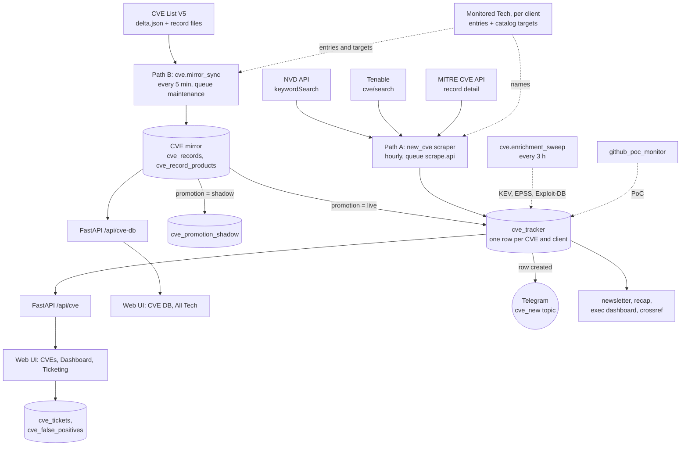

## 2. The pieces

### 2.1 Monitored Tech (the watch list)

`techstack_entries`, unique on `(name, client_id)`. Three kinds of entry coexist:

| Kind | How it was created | How it matches (Path B) | How it matches (Path A) |
|---|---|---|---|
| **Catalog entry** | "Monitor" button in All Tech (`vendor_id` or `family_id`) | Only through its **targets**: a CVE matches if one of its products belongs to a target family (precise) or target vendor (every product of the vendor). The entry's name is *not* matched as text. | By **name** only. Targets are invisible to Path A. |
| **Mapped legacy entry** | A custom entry that got targets via "Map to catalog" / Targets | Same as catalog entry. | By name only. |
| **Custom (unmapped)** | "Add custom" with just a name; shown as `Unmapped · name text` | The legacy **text gate** (`relevant_techs`) against the CVE's vendor/product text, summary as fallback. | By name. |

Flags per entry: `exposure` (`internal`/`public`/`both`), `hosting_type` (`on_prem`/`cloud`/`saas`),
`active` (paused entries are ignored by both paths and hidden from the CVEs tab; their rows are kept).

`cve_tracker.tech` stores the **entry name**, and the UI joins on it as lower-case text. Renaming an
entry breaks the join; there is no foreign key.

### 2.2 Path A: the `new_cve` scraper (legacy, hourly)

`scrapers/src/cti_scrapers/feeds/new_cve.py`. Candidate-finding is by **keyword**, then filtered by a
text gate. See the low-level flow in 4.1.

### 2.3 Path B: mirror, catalog, promotion

`cve.mirror_sync` copies every published CVE into our own database (the **mirror**), resolves each
record's `(vendor, product)` to catalog vendors and families, and then **promotes** matching records into
`cve_tracker` according to the Monitored Tech entries. See 4.2 to 4.4.

### 2.4 The tracker row

`cve_tracker`, unique on `(cve_id, client_id)`: one row per CVE per client, and **one tech per row**.
When several of a client's entries match, the most specific wins (Path B: family > vendor > text, then
alphabetical), or the alphabetically first (Path A). Children: `cve_references`, `cve_affected` (replaced
whole on every upsert), `cve_pocs`. Enrichment columns (KEV, EPSS, Exploit-DB, PoC) are written by other
jobs and never by the upsert.

`detected_on` is set by the database on first INSERT and never changed. It is the basis of MTTD/MTTA/MTTR
and of the "Newest CVE detected" line in the UI.

## 3. Which path is active

Read once per process, so a change needs a restart of `worker`, `beat` and `api`.

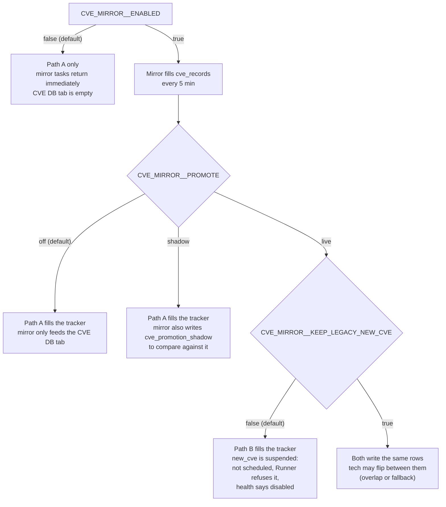

How to tell which is active without shell access: `GET /api/cve/freshness` lists `sources`. A `new_cve`
entry means Path A is running; a `mirror` entry means Path B is `live`. Both can appear. On 2026-10-15
production listed only `new_cve` while the CVE DB tab held 122,864 CVEs: the mirror was enabled and
`PROMOTE` was `off` or `shadow` (the API does not say which).

Cutover and rollback steps: `docs/CVE_CATALOG_CUTOVER.md`. Rollback is a flag, never a migration.

## 4. Low-level flows

### 4.1 Path A: one `new_cve` run

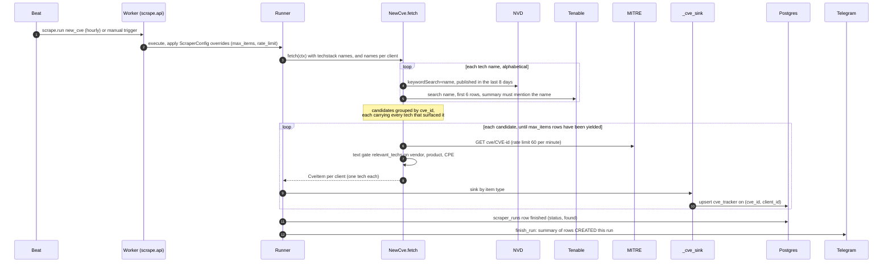

The fetch step in detail:

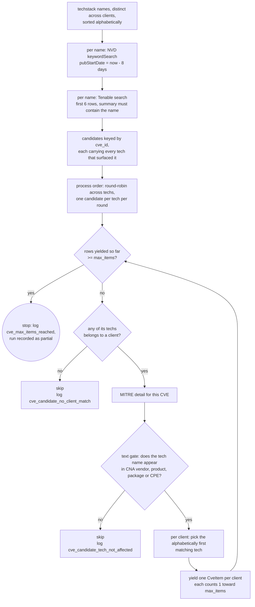

Properties that matter when something is missing:

- **`max_items` counts rows (CVE x client), not CVEs.** Candidates are processed round-robin across techs, so a
  capped run cuts thinly everywhere instead of removing the end of the alphabet. A run that stops at the cap
  logs `cve_max_items_reached` (remaining candidates, first affected tech, pending techs) and is recorded as
  **`partial`**. Before PR #50 (2026-10-15) candidates were walked tech by tech, a capped run was `ok` and
  nothing was logged: section 7.2 is that case.
- NVD is asked with the tech *name* as a keyword over **published** dates of the last 8 days. A CVE older
  than 8 days that the scraper never caught is not retried by Path A; it needs a backfill.
- The gate decides relevance, not NVD. The text gate (`cti_core.tech_match`): lower-case, whole words, a
  trailing version digit run of up to 4 digits is allowed (`graylog2-server` matches `graylog`), terms under 2
  characters never match.
- `dedup_key()` is `None`: every run re-upserts every candidate, because MITRE may have changed a score.
  Counters in the run table (`NEW`) therefore are not "new CVEs".
- A row is **created** (INSERT) at most once. Only creation triggers Telegram (4.7).

### 4.2 Path B: one `cve.mirror_sync` tick

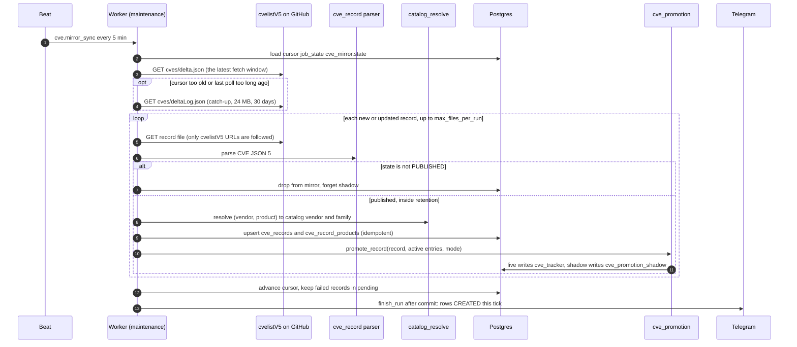

Behaviours worth knowing:

- **The cursor lives in the database** (`job_state["cve_mirror.state"]`: last processed `fetchTime`, `polled_at`,
  `pending`). It moves forward only after a batch finishes; repeating a batch is harmless because upserts are
  idempotent and refuse older data.
- **Gaps**: `delta.json` holds one window, so a dead worker misses windows that were overwritten. Catch-up reads
  `deltaLog.json` when the last successful poll is too old or the new `fetchTime` is too far from the cursor. If
  the cursor is older than the oldest log entry the report says `gap_unrecoverable`; the only cure is
  `make backfill-cve-mirror SOURCE=<clone or zip of cvelistV5>`.
- A failing record does not stop the batch: it goes to `pending` and is retried next tick (a bounded number of
  attempts, then dropped with a log line). Records beyond `max_files_per_run` (default 3000) wait in `pending`
  without using an attempt.
- Only **PUBLISHED** records are stored. Records without a publish date, or published before the retention
  cutoff, are skipped. **Retention** is calendar-year: January 1st of the *previous* year (2025-01-01 during
  2026). `cve.mirror_purge` trims daily at 03:30 UTC.
- The CVE DB tab and `/api/cve-db` read the mirror, not the tracker. A CVE present there and absent from the
  CVEs tab is exactly the symptom "ingested, but not promoted".

### 4.3 Promotion: which entry wins

`cti_core.cve_promotion.choose` is pure (no database), so the rules are locked by plain unit tests.

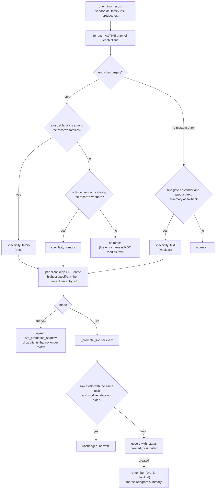

Notes:

- `live` never deletes an existing tracker row, even if the CVE stops matching: tickets and false-positive marks
  are keyed by `(cve_id, client_id)` with no foreign key to the tracker.
- When the record has no CVSS the row gets score `0.0` and an empty vector (same defaults as Path A), which the
  UI shows as **Unrated**.
- Promotion has no 8-day lookback like Path A. A sync tick promotes the records it just ingested; adding or
  changing an entry promotes that entry's whole history from the mirror (4.4); `make promote-cve-mirror` can
  replay the entire mirror. Its `--since YYYY-MM-DD` limit is what you use at cutover so old history does not
  flood the tracker with `detected_on = now` and spoil MTTD.

### 4.4 Changing the watch list (Path B only)

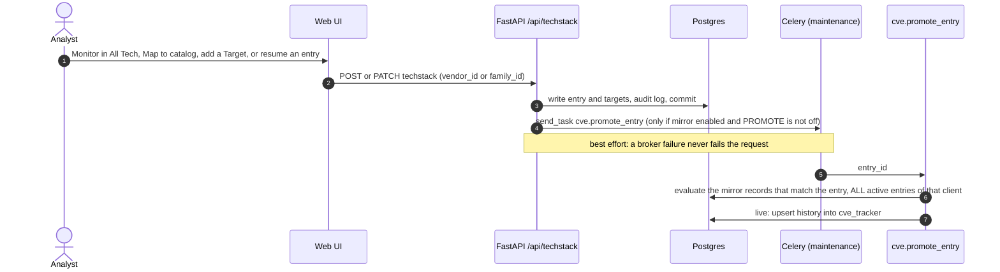

So a newly monitored tech gets its **history** from the mirror within minutes, with no "Populate now" button.
If the task could not be sent (`promote_entry_enqueue_failed` in the API log), run
`make promote-cve-mirror MODE=live ARGS='--apply --entry <name>'`.

Under Path A, adding an entry only changes the next hourly run (the keyword list), and the run only looks 8
days back.

### 4.5 Enrichment (both paths)

`cve.enrichment_sweep` runs every 3 hours at minute 0 UTC on the `maintenance` queue. Three independent steps
(one failing does not stop the others), over every CVE that is still a true positive for at least one client,
written to **every** row of that CVE across clients:

| Step | Source | Writes |
|---|---|---|
| CISA KEV | whole catalog downloaded, matched by id | `cisa_kev`, `active_exploitation`, `cisa_kev_detail` |
| Exploit-DB | site scraping, batches of 5 with a 1 s pause | `exploit_db_hits`, adds `cve_pocs` |
| EPSS | FIRST.org, batches of 100 | `epss_score`, `epss_percentile`, `epss_date` |

There is no freshness filter: everything is re-checked each time, so the cost grows with the tracker. The
"CISA KEV / EPSS / Exploit-DB Lookup" buttons run the same code on demand. `github_poc_monitor` (a scraper)
sets `poc_available` and `cve_pocs` separately.

### 4.6 Reading it: what the CVEs tab shows

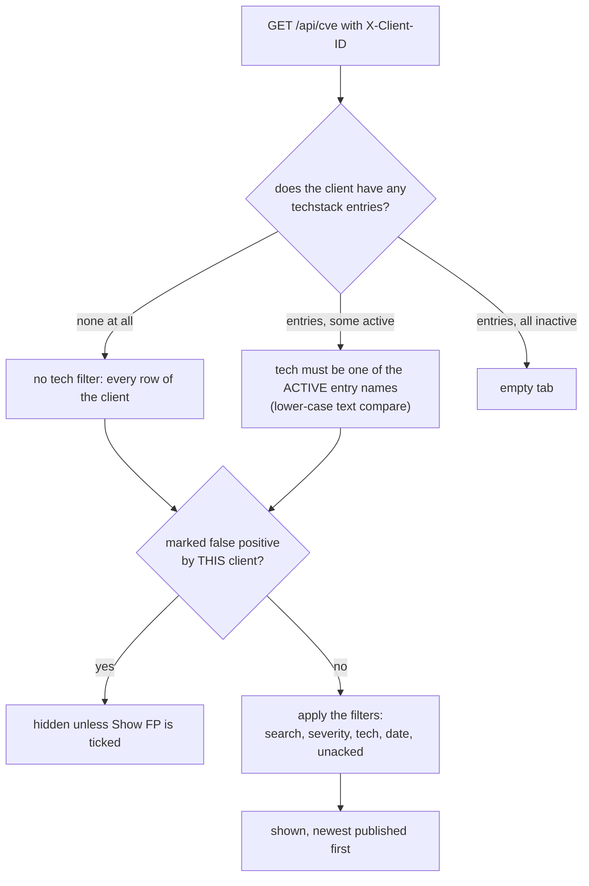

Same scope for `/api/cve/stats`, the Dashboard sub-view and the Excel export, so the numbers agree. A row whose
entry was deleted or paused stays in the database but is hidden (an "orphan" until `purge-orphaned` runs, which
never deletes rows that have a ticket or acknowledge).

**Freshness line** ("Updated ... · Newest CVE detected ... · Next auto-check in ..."): `GET /api/cve/freshness`.
"Updated" is the last *successful* run (`ok`, `empty`, `partial`) of the active path; a failed last attempt is
reported separately so it does not look refreshed. A `running` row older than 30 minutes counts as stuck.
**Check for new CVEs** (`POST /api/cve/check-new`, admin) sends the routine check for the active path
(`scrape.run new_cve` with trigger `manual`, or `cve.mirror_sync`). It answers **409** while a check is running
or the scraper is disabled, **429** during the 120 s cooldown, **503** when the broker is down.

### 4.7 Telegram: the new-CVE summary

Both paths record each **created** `(cve_id, client_id)` in `Session.info["cve_new_rows"]`; after the run is
committed, `finish_run` calls `cti_scraper.cve_alert.notify_new_cves`.

- One message per client per run, to the `cve_new` topic of `TELEGRAM__THREAD_IDS` (value `0` = main chat).
- Only CVEs **published within the last 3 days** and not false positives of that client; at most 10 listed,
  most severe first, the rest "and N more"; always under 4096 characters.
- A send failure never fails the run and is not retried (`cve_new_alert_failed`). If the topic is not
  configured, nothing is sent and ingest carries on.
- Because only INSERT counts, the first run after a tech is added or after a backfill is quiet for old CVEs
  and a CVE that was already in the tracker never alerts twice.

Other CVE messages (weekly top CVE, trending CVE, GitHub PoC, article alerts) are separate jobs, listed in
`docs/CVE_TRACKER_FLOW.md` section 7.

### 4.8 Analyst workflow

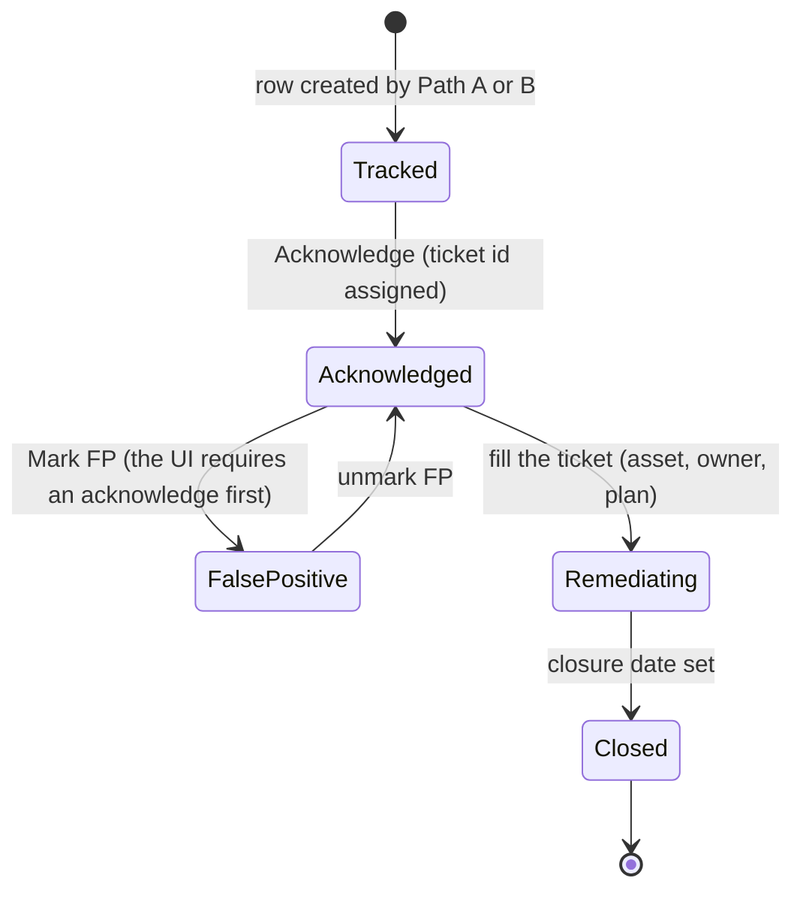

- **Acknowledge** (single or bulk, max 100): `acknowledged_by` is the logged-in user, never a typed name. The
  first acknowledge wins and sets `acknowledge_time` (MTTA) and a ticket id `CTI-YYYY-MM-NNN`, numbered
  sequentially per WIB month across all clients.
- **Ticket** (`PUT /api/cve/{id}/ticket`): asset, versions, owner, remediation status/dates, escalation, risk
  acceptance, closure date. Status values are a soft enum with no validation.
- **False positive** is per `(cve_id, client_id)`. Only the client that owns the row counts; one client's mark
  never hides the CVE from another.
- Tickets, acknowledges and FP marks are only accepted for CVEs the calling client tracks (404 otherwise), and
  `cve_id` is normalised and validated (`CVE-YYYY-NNNN`, upper case) before anything is written.
- **Draft email** is manual: three LLM calls plus a template, saved as a Microsoft Graph draft.

## 5. Data model

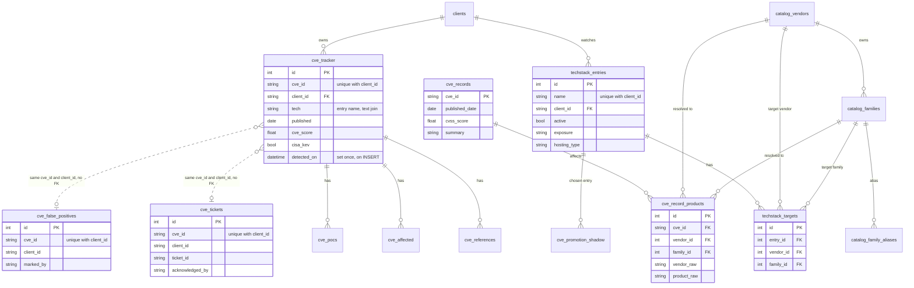

The mirror (`cve_records`) is global: it is not per client. Everything per client starts at `cve_tracker`.

## 6. Operating it

### 6.1 Where to look

| Question | Where |
|---|---|
| Which path is active, when did it last succeed, is it running | CVE Tracker > CVEs, line under the filters; `GET /api/cve/freshness` |
| Did the last runs hit a cap or fail | Scrapers > `new_cve` > Recent Runs: `FOUND` equal to the configured max is a red flag |
| Is the CVE in our mirror at all | CVE Tracker > CVE DB (search the id); `GET /api/cve-db/{cve_id}` |
| Is the CVE in the tracker, even hidden or FP | `GET /api/cve?search=<id>&include_fp=true` with the right `X-Client-ID` |
| What does an entry match | Monitored Tech > Targets (Path B); the entry name (Path A) |
| What would the mirror promote, without writing | `make compare-promotion-shadow SINCE=<date>` (needs shadow mode) |
| Sync health, gaps | worker log for `cve.mirror_sync`; the report has `gap_unrecoverable` |

All of the `GET` calls are read-only and work from a logged-in browser session through `/api/proxy/api/...`.

### 6.2 Scraper control plane (Path A)

The Scrapers page can override a scraper's `schedule`, `rate_limit`, `max_items` and `paused_reason`, or disable it.
They live in `ScraperConfig`, so they **outlive deploys and are invisible in code review**.

| Override | Takes effect |
|---|---|
| `max_items`, `rate_limit` | next run |
| `schedule`, `enabled` | after `beat` restarts (the schedule is built once at import); `Runner` rechecks `enabled` at run time |

**Reset to Defaults** deletes the whole override row (schedule, rate limit, max items, paused reason), not just one
field. **Trigger** (`POST /api/scraper/{id}/trigger`, admin) queues a manual run right away. The endpoint itself
does not check whether a run is already going (the CVEs-tab button does, with a 409), so look at Recent Runs
first.

Run statuses: `ok`, `empty`, `partial` (a `new_cve` run that stopped at its cap, 4.1), `parse_error`,
`fetch_error`, `rate_limited`, `backpressure`, `disabled`. `freshness` counts `ok`, `empty` and `partial` as a
successful check.
A 300-row `new_cve` run took about 7 to 11 minutes on production (MITRE is rate-limited to 60 per minute), so give
a manual run that long before judging it.

### 6.3 Config reference

| Setting | Default | Effect |
|---|---|---|
| `CVE_MIRROR__ENABLED` | `false` | `cve.mirror_sync` and `cve.mirror_purge` return immediately when off |
| `CVE_MIRROR__PROMOTE` | `off` | `off`, `shadow`, `live` (section 3) |
| `CVE_MIRROR__KEEP_LEGACY_NEW_CVE` | `false` | with `live`, keep `new_cve` running too |
| `CVE_MIRROR__MAX_FILES_PER_RUN` | `3000` | record downloads per tick; the rest wait in `pending` |
| `CVE_MIRROR__REQUEST_TIMEOUT_S` | `30` | per download; `deltaLog.json` gets 3x |
| `TELEGRAM__THREAD_IDS` | | must contain `cve_new` for the new-CVE summary |
| `new_cve` `max_items` (code default) | `600` | rows per run (CVE x client); the scraper contract test caps a code default at 1000; override in the control plane |

New required keys must be on the production host **before** merging, or the app will not start (see
`CLAUDE.md`, Config).

## 7. Troubleshooting: "CVE X is not in the CVEs tab"

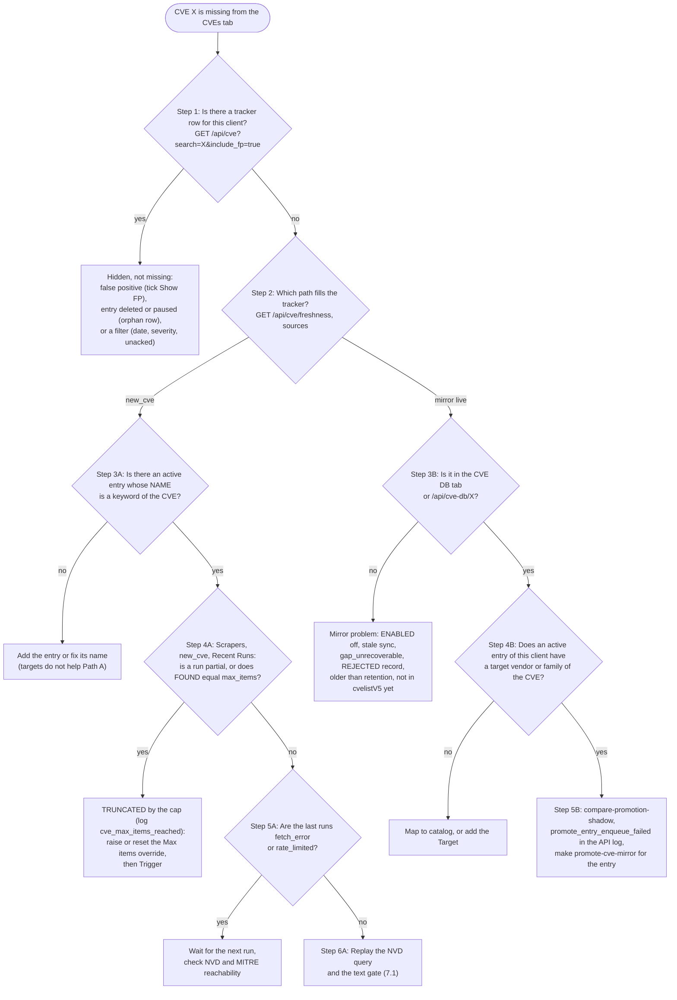

If `freshness` lists both sources (an overlap with `KEEP_LEGACY_NEW_CVE=true`), walk the `new_cve` branch first and
then the mirror branch: either one can be the one that is failing.

### 7.1 Replaying Path A by hand (read-only, public data)

NVD with the exact query the scraper builds (window = the last 8 days; replace the dates and the keyword,
`%20` for spaces):

```bash
curl -s "https://services.nvd.nist.gov/rest/json/cves/2.0?keywordSearch=palo%20alto&pubStartDate=2026-10-07T00:00:00.000%2B00:00&pubEndDate=2026-10-15T00:00:00.000%2B00:00"
```

If the CVE is in that answer, the candidate is found and the loss happened later (cap or gate). Then ask MITRE
for the record the gate sees and run it through the same function:

```bash
uv run python - <<'EOF'
import json, urllib.request
from cti_core.cve_record import parse_cve_record
from cti_core.tech_match import relevant_techs

cve_id, tech = "CVE-2026-0322", "palo alto"
data = json.load(urllib.request.urlopen(f"https://cveawg.mitre.org/api/cve/{cve_id}"))
cna = data["containers"]["cna"]
summary = next(d["value"] for d in cna["descriptions"] if d["lang"].startswith("en"))
detail = parse_cve_record(data, cve_id=cve_id, link="", summary=summary)
print(relevant_techs([tech], summary, detail.products))  # ['palo alto'] = passes, [] = rejected
EOF
```

NVD without an API key allows about 5 requests per 30 seconds: pause between keywords.

### 7.2 Case study: Palo Alto, 2026-10-15

Symptom: after a manual "Check for new CVEs", the Palo Alto advisories of 2026-10-14 (CVE-2026-0311 to
CVE-2026-0322) were absent, although the CVE DB tab had CVE-2026-0322.

| Step | Finding |
|---|---|
| Mirror | CVE-2026-0322 present (published 2026-10-14). Mirror healthy, so Path B was not the problem. |
| Active path | `freshness` listed only `new_cve`: Path A fills the tracker. The mirror was not `live`. |
| Entry | `palo alto` active, mapped to the vendor *Palo Alto Networks*. Irrelevant to Path A, which uses the name only. |
| Candidates | The NVD replay returned all 12 CVEs. |
| Gate | Replaying `relevant_techs` on the MITRE records: all 12 pass (vendor `Palo Alto Networks`). |
| Tracker | `GET /api/cve?tech=palo alto&include_fp=true` returned 0 rows, ever. |
| Run history | Every `new_cve` run showed `FOUND = 100`, status `ok`, `DROPPED = 0`. |
| Config | Scrapers > `new_cve`: **Max items = 100** (default 300), an override recorded as set by `stg-admin` on 2026-09-28. |

Cause: with the cap at 100 and candidates walked in alphabetical tech order, the run stopped long before
reaching `palo alto` (after `fortinet`, `gitlab`, `juniper`, ...). Nothing logged it and the run was `ok`.

Fix applied on production: Reset to Defaults on the override, which gave `FOUND = 300`: Palo Alto appeared,
Juniper went from 59 to 153 rows, and `n8n` and `nessus` rows that had been silently dropped appeared too.
`FOUND` was still exactly the default cap, and a Wazuh CVE (CVE-2026-93347, published 2026-10-13, passes the
gate) was still missing, so the override was set to 600: the next run found 308 rows with status `ok`, and the
CVE appeared.

Takeaways: a run that ends at exactly its cap is truncated, not "done"; overrides in the control plane are state
that no code review sees; the 8-day window for one client was already over 300 rows during Juniper's bulletin.

Follow-up in code (PR #50, merged to `main` the same day): round-robin processing across techs, the
`cve_max_items_reached` warning with the `partial` status, and a default of 600 (4.1, 6.2, 6.3). Production runs
the older code until the next `make deploy`, so the **Max items = 600 override set that day stays in force**; once
the new code is live it is redundant and can be removed with Reset to Defaults.

## 8. Known limits

- Path A only sees CVEs published in the last 8 days, and only by keyword. A tech whose NVD description never says
  its name is invisible to it.
- Path A and Path B can disagree about `tech` for the same CVE when both run (`KEEP_LEGACY_NEW_CVE=true`): the row
  flips to whichever wrote last.
- The enrichment sweep has no freshness filter, so its cost grows with the tracker.
- `cve_threat_actors` and `cve_ttps` have no writer in this repository; `crossref` only reads them.
- Ticket status values are a soft enum with no validation (ROADMAP #18).
- The mirror is global but promotion is per client: a monitored tech with the wrong target (a vendor that is too
  broad) floods the tracker with that vendor's CVEs, and the Telegram summary only dampens it to the last 3
  days.

## 9. Where the code lives

| Area | Path |
|---|---|
| Path A scraper | `scrapers/src/cti_scrapers/feeds/new_cve.py` |
| Run framework, overrides, statuses, suspension | `packages/cti-scraper/src/cti_scraper/runner.py`, `supersede.py` |
| Telegram summary | `packages/cti-scraper/src/cti_scraper/cve_alert.py` |
| CNA parsing, text gate | `packages/cti-core/src/cti_core/cve_record.py`, `tech_match.py` |
| Mirror sync | `packages/cti-core/src/cti_core/cve_mirror_sync.py`, worker task `apps/worker/src/cti_worker/tasks/cve_mirror.py` |
| Catalog resolver | `packages/cti-core/src/cti_core/catalog_resolve.py` |
| Promotion | `packages/cti-core/src/cti_core/cve_promotion.py` |
| Beat schedule | `apps/worker/src/cti_worker/beat.py` |
| Enrichment sweep | `apps/worker/src/cti_worker/tasks/periodic.py` (`cve.enrichment_sweep`), `cti_api/services/cve_lookup.py` |
| CVE API, freshness, check-new | `apps/api/src/cti_api/routers/cve.py`, `services/cve_check.py` |
| Monitor API and promote trigger | `apps/api/src/cti_api/routers/techstack.py`, `services/monitor.py` |
| CVE DB and catalog API | `apps/api/src/cti_api/routers/cve_db.py`, `catalog.py` |
| Models | `packages/cti-core/src/cti_core/db/models/cve.py`, `cve_mirror.py`, `techstack.py`, `catalog.py` |
| Web | `apps/web/src/app/(app)/cve/` |
| Ops tools | `tools/ops/` (`backfill_cve_mirror.py`, `promote_cve_mirror.py`, `compare_promotion_shadow.py`, `catalog_mapping.py`, `reconcile_cve_tech.py`) |
| Tests | `tests/unit/test_new_cve_*.py`, `test_cve_promotion.py`, `test_cve_mirror_sync.py`, `test_cve_alert.py`; `tests/integration/test_cve_promotion.py`, `test_cve_mirror_sync.py`, `test_cve_check_api.py` |
