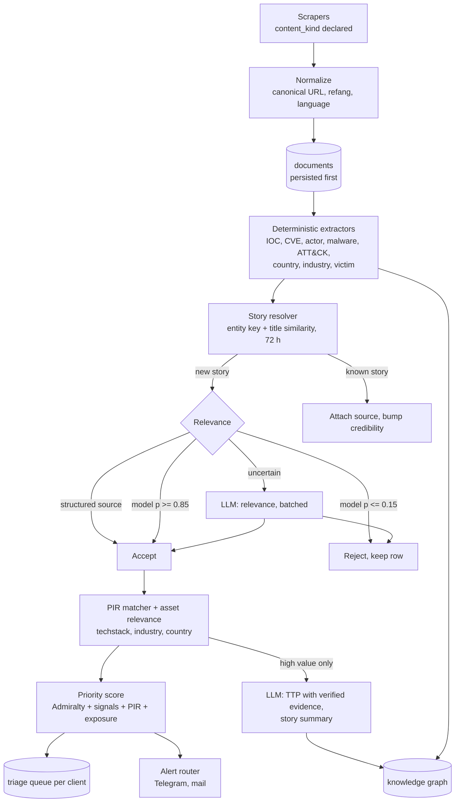
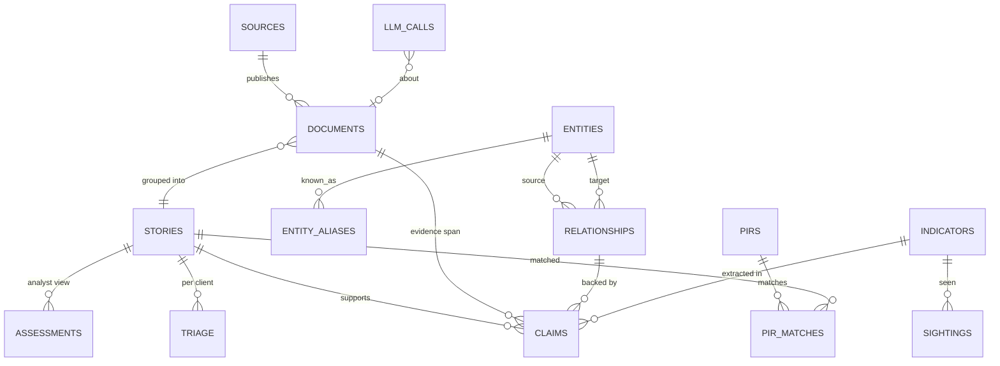

# Target architecture: from news aggregator to CTI platform

Status: **in progress** (updated 2026-10-24): the security half of step 1 shipped in 0.8.4, see
section 7. Companion to `docs/LLM_ASSIST_REDESIGN.md`, which
holds the evidence (E1-E16) and the enrichment detail. This document covers the whole system:
backend flow, database, API contract and web. It is a redesign of v1 in this repository,
delivered as a strangler: new tables and `/api/v2` endpoints next to the old ones, pages moved
one by one, old parts removed when nothing reads them.

## 1. Why the shape has to change

Today the product is "articles with tags": each article is enriched alone, the LLM decides
relevance and TTPs, and every page aggregates `articles` at read time. The inventory of the
current code shows what stops it being a CTI platform:

| Area | Current state (verified in code) |
|------|----------------------------------|
| Unit of intelligence | The single article. No story/report entity; the same event from 16 sources is 16 rows. Two clustering pipelines (`services/cluster.py`, `services/campaign.py`) recompute at read time, one is never persisted. |
| Entities | An actor lives in about 9 places with no shared id (`ta_whitelist`, `ta_watchlist`, `threat_actor_groups`, `attack_groups`, `ta_profiles`, string links in `article_threat_actors`, `ioc_threat_actors`, `cve_threat_actors`, `ransomware_victims.group_name`). No malware or campaign table. `cve_threat_actors` and `cve_ttps` are never written. |
| Relationships, evidence | None outside ATT&CK. Link tables carry no confidence or provenance. |
| Markings | No TLP column anywhere; STIX export has no marking definitions and maps PIRs to `course-of-action`. |
| Feedback | IOC TP/FP exists (1 IOC used), no sightings, no triage state on anything except CVEs. |
| API | 212 operations, only 57 typed; collection keys differ per router (`items`, `articles`, `iocs`, `rfis`...); several GETs write (`attack/sync/{key}`, mindmap generate). 26 permissions are stored but **no router checks a permission** (only `require_auth/admin/superadmin`). An unknown `X-Client-ID` silently falls back to the user's first client (`deps.effective_client_id`). `crossref/pir/{id}` and `stix/pirs` read PIRs across clients. No API tokens, TAXII or feeds. |
| Web | 11 flat sidebar items, 4 dashboards that overlap, 3+ actor views that do not link to each other, every detail is a modal (nothing deep-linkable), no triage queue, no entity pages. |

Since 0.8.4 the API row above is partly fixed: permissions are enforced on every route, a
foreign `X-Client-ID` is 403, and the PIR leaks (`crossref`, `stix/pirs`, PIR mindmaps) are
closed. The rest of the row (untyped responses, envelopes, GETs that write) is still open.

## 2. Backend: target flow

Rules that span the flow:

- **Persist first, enrich in steps.** Each stage is its own Celery task writing its own
  columns and a `stage_status`. An LLM outage leaves documents in `pending_llm`, it never
  turns them into rejections (E4).
- **Extractors are versioned plugins**, like scrapers: one file per extractor, declared
  inputs/outputs, `extractor_version` stored with every claim, so a fix can be re-run
  (`cti-enrich rerun --extractor actor_dict --since 30d`).
- **Every derived fact is a claim with evidence**: what, from which document, which span,
  which extractor or LLM call, confidence. The UI can always answer "why does it say this".
- **Read models are precomputed** by the worker (spikes, risk matrix, campaign trends, exec
  dashboard, CVE metrics, FP analytics) into small tables, replacing per-process TTL dicts
  that are not shared across uvicorn workers.
- **LLM gateway** in `cti_core.llm`: the only way to call a model; per-task model, prompt
  version, cache by input hash, schema validation, empty-output rejection, token logging,
  per-task daily budget with degrade-to-deterministic, startup probe surfaced on Data health.

Package layout (same workspace, new modules):

| Package | Change |
|---------|--------|
| `cti-core` | `db/models/{document,story,entity,relationship,claim,sighting,marking,triage,llm}.py`; `llm/gateway.py`; `kg/` repository (upsert entity by alias, add relationship with evidence) |
| `cti-enrich` | `extractors/` (plugins), `story.py`, `relevance/` (model + training script), `stages/` become thin tasks; `classify.py` and `extract_ttps.py` move behind the gateway as `llm_tasks/` |
| `cti-api` | `routers/v2/*` resource routers, `services/readmodels/*`, permission dependency `require(perm)` |
| `cti-worker` | `tasks/{extract,story,relevance,llm,readmodels,sightings,feeds}.py` |
| new `cti-connectors` | Splunk (sightings in, lookup export out), TAXII 2.1 server, later MISP/OpenCTI |

## 3. Database

### 3.1 New core model

| Table | Key columns | Replaces / absorbs |
|-------|-------------|--------------------|
| `sources` | id, name, url, `content_kind`, `reliability` (A-F), `default_tlp`, scraper_id | `source_reliability_entries` (now FK, not name match), static `/source-scores` heuristic |
| `documents` | id, source_id, url, url_hash, title, published_at, text_hash, lang, `stage_status`, `relevance` (+ `relevance_by`: rule/model/llm/analyst), story_id | `articles` + `rejected_articles` (a rejection is a status, not a table) |
| `stories` | id, title, first_seen, last_seen, `source_count`, `credibility` (1-6), `priority`, summary, summary_by, `tlp` | `clusters`, on-the-fly campaigns |
| `entities` | id, `type` (intrusion_set, malware, tool, campaign, vulnerability, identity/victim, sector, country, attack_pattern), name, stix_id, description, first_seen, last_seen, `tlp` | `threat_actor_groups`, `attack_groups`, `attack_software`, `ta_whitelist` (becomes a flag), `ta_profiles` (becomes `entity_profiles` with draft/approved state), `monitored_people` |
| `entity_aliases` | entity_id, alias, source | aliases scattered today |
| `relationships` | src_entity, `type` (uses, targets, attributed-to, exploits, indicates, variant-of), dst_entity, confidence, first_seen, last_seen, `tlp` | `article_threat_actors`, `ioc_threat_actors`, `cve_threat_actors`, `cve_ttps`, `article_ttps` (as story→attack_pattern) |
| `claims` | id, subject (relationship / indicator / story field), document_id, `span_text`, `method` (explicit, dictionary, inferred, llm, analyst), extractor_version, llm_call_id, confidence | `raw_enrichment` JSON as the only provenance |
| `indicators` | type, value (refanged, normalized), `state` (active, expired, revoked, allowlisted), valid_from, valid_until, confidence, `tlp` | `iocs` (CVE moves out to `entities` type vulnerability) |
| `sightings` | indicator_id, client_id, source (splunk...), count, first_seen, last_seen | none today |
| `triage` | client_id, story_id, status (new, in_review, assessed, dismissed), assignee, due_at | none (CVE ack/tickets stay as they are) |
| `assessments` | story_id or entity_id, client_id, key_judgment, admiralty (e.g. B2), recommended_action, `tlp`, author, status (draft, published) | PIR notes, ad-hoc newsletter text |
| `pir_matches` | pir_id, story_id, matched_on, at | computed at read time in `services/pir.py` |
| `llm_calls` | at, task, model, prompt_version, input_hash, tokens_in/out, latency_ms, status (ok, empty, invalid, error), subject | `token_usage` JSON on 3 tables |
| `readmodel_*` | small precomputed tables per dashboard | in-process TTL caches |

Kept as they are (already a good model): CVE tracker, tickets, techstack, catalog,
`cve_records` mirror, package vulns, auth/clients/roles/audit, runtime secrets, scraper runtime
tables, ATT&CK reference tables (their objects are also upserted into `entities` so links have
one id).

### 3.2 Tenancy

Shared corpus (documents, stories, entities, relationships, claims, indicators) stays global.
Everything a client decides or owns is per client: triage, assessments, sightings, PIR and
matches, watchlists, techstack, CVE work. Exports filter by TLP and client. Close the two PIR
leaks and return 403 for an `X-Client-ID` the user does not belong to.

### 3.3 Migration of existing data

All of it is mechanical: `articles` → `documents` + one story each (then re-clustered by the
story resolver), actor strings → `entities` by alias match (unmatched become `entities` with
`source=legacy`), `iocs` → `indicators` with refang dedup (merging `x[.]y` and `x.y`), raw LLM
JSON kept as `claims` with `method=llm` so nothing is lost. Hand-written Alembic migrations, as
the repo already does; `test_migrations_match_models.py` keeps them honest.

## 4. API contract (`/api/v2`)

Conventions, applied to every v2 endpoint:

- Envelope `{items, next_cursor, total?}`; cursor pagination; one error shape
  `{error: {code, message, details}}`; every response typed (no more `loose-types.ts`).
- `securitySchemes` in OpenAPI: session JWT (web) and **scoped API tokens** (machines).
- Every route declares a permission: `Depends(require("stories:triage"))`.
- No GET writes. Long or LLM work is a **job**: `POST` returns `202 {job_id}`,
  `GET /jobs/{id}` returns status and result.
- TLP filter applied server-side on every read and export.

| Resource | Main operations |
|----------|-----------------|
| `/stories` | list (filters: priority, PIR, entity, client relevance), get (documents, claims, entities, timeline), merge, split |
| `/documents` | list, get, set relevance (analyst override feeds training) |
| `/triage` | queue for the client, `PATCH` status/assignee |
| `/entities/{type}` | list, get (profile, aliases, relationships, timeline, indicators, stories), create, merge, edit; `POST /entities/{id}/profile:draft` (LLM job) |
| `/relationships` | list by entity, create/confirm/reject (analyst) |
| `/indicators` | list, get (claims, sightings, enrichment), `PATCH` state, feedback |
| `/sightings` | ingest (token, from Splunk), list |
| `/assessments` | CRUD, publish |
| `/pirs`, `/rfis` | as today plus matches and linked stories |
| `/products` | recap, newsletter, exec brief as jobs; history |
| `/exports` | STIX 2.1 bundle (with markings), CSV, Splunk lookup |
| `/taxii2/` | discovery, collections, objects (token, TLP-scoped) |
| `/search` | one search over stories, entities, indicators, CVEs |
| `/ops/*` | data health, scrapers, extractors, `llm/usage`, readmodel freshness |

Generated as today (`tools/export_openapi.py`, `pnpm run gen:api`). v1 endpoints stay until
their last page moves, then are removed in the same PR as the page (the 20-odd endpoints the
web never calls can go first: crossref x3, stix x4, source-scores, exec v1, etc.).

## 5. Web: information architecture

Sidebar grouped by analyst job instead of by data source:

| Group | Pages | From today |
|-------|-------|------------|
| Home | Analyst home: my triage queue, PIR hits, attention items | Dashboard + attention band |
| Triage | Story queue (new / in review / assessed / dismissed), story page | Newsroom (articles become sources inside a story) |
| Explore | Actors, Malware, Campaigns, Vulnerabilities, Indicators, ATT&CK; each with a URL-addressable page: profile, relationships graph, timeline, evidence, related stories | TA Room, ATT&CK DB, IOC management, MITRE heatmap, campaign clusters (merged) |
| Exposure | Assets (techstack), CVE tracker, Sightings | CVE tracker (unchanged), new sightings |
| Requirements | PIRs, RFIs | Intelligence > PIR, RFI |
| Products | Recap, Newsletter, Exec brief, Exports and feeds | Recap, Newsletter, Exec |
| Operations | Sources (reliability + scraper status), Data health (incl. LLM usage and extractor runs), Admin | Scrapers, Data health, Source reliability, Admin |

Pages that disappear by merging: separate Exec dashboard metrics duplicated elsewhere
(spikes, top TTPs, TA velocity become panels on Home/Explore), Early warning (spikes become
attention items on Home), "Clusters (Simple)" vs "Campaigns" (one story/campaign model).
Modals stay for quick looks, but every object has a real route (`/stories/[id]`,
`/entities/[type]/[id]`, `/indicators/[type]/[value]`) so links can be shared.

## 6. Where the LLM sits, end to end

| Task | When | Input | Guard |
|------|------|-------|-------|
| `relevance.uncertain` | model is unsure, batched | titles + short lead | budget, cache, fallback = keep pending |
| `ttp.extract` | high-value story only | full text | evidence span must exist in text |
| `story.summary` | once per story, on first accept and on major update | top documents | schema, length |
| `entity.profile.draft` | analyst request | entity claims + stories | draft until analyst approves |
| `product.recap`, `product.newsletter`, `product.exec_brief` | scheduled or on request | precomputed structured data, not raw articles | empty-output guard, grounding check (exists) |
| `cve.email` | analyst request | CVE record | fields computable from CVSS/affected data are filled by code, not asked |

Everything else (IOC, CVE, actor, malware, ATT&CK explicit/inferred, countries, industry,
incident flag, dedup, scoring, routing, PIR matching) is deterministic.

## 7. Delivery order

Each step is one PR, merged to `Dev` first. Steps 1-3 change nothing the user sees except
reliability; steps 4-7 move pages one at a time.

1. **Foundation**: LLM gateway + `llm_calls`, model health probe, self-healing replay of
   articles parked as `[enrichment_failed]`, permission enforcement + 403 on bad client header +
   PIR leak fix, v2 conventions in the API.
2. **Sources and indicators**: `sources` table (reliability as FK), `content_kind`, refang
   dedup, CVE out of IOCs, allowlist seed, indicator state/expiry.
3. **Extractors and claims**: plugin framework, dictionary/ATT&CK/industry extractors, claims
   with evidence, TTP evidence check; shadow-compare against current LLM output.
4. **Stories and triage**: `documents` table with persist-first `stage_status` (an LLM outage
   leaves documents pending instead of parked), story resolver, `/api/v2/stories`, triage queue
   page, story page; Newsroom becomes a view of it.
5. **Entities**: unify actors/malware/campaign into `entities` + relationships, entity pages,
   retire TA Room/ATT&CK DB/campaign pages into Explore.
6. **Relevance model + Admiralty**: local model gate, grade every source, priority score,
   alerts driven by priority.
7. **Sharing and feedback**: TLP everywhere, STIX fix, TAXII 2.1, scoped tokens, Splunk
   sightings in and lookup export out, assessments, products reading read-models.

### Progress

| Step | State | Notes |
|------|-------|-------|
| 1. Foundation, security half | **Done in 0.8.4** (PR #73) | `require_permission` on every `/api` route with a coverage test (`tests/unit/test_route_permissions.py`); new permissions `manage_cve` and `view_ops` for analysts; 403 for a foreign `X-Client-ID` (the web proxy drops such a header); `crossref`, `stix/pirs` and PIR mindmaps scoped to the active client; `/api/auth/me` returns `permissions` and the web hides the controls a role cannot use (`useCan()`). |
| 1. Foundation, remaining | Not started | LLM gateway + `llm_calls`, model health probe on Data health, self-healing replay of parked articles, v2 API conventions. Still cross-client, to scope next: CVE list in TA profiles (`ta_profile.py`), CVE priority and campaign analysis (`list_by_cve_ids_any_client`), CVE mindmaps. |
| 2. Sources and indicators | Not started | Feed dates (0.8.3) are a prerequisite already in place. |
| 3. Extractors and claims | Not started | Software masking and longest-name matching for actors (0.8.3) are a first piece. |
| 4-7 | Not started | |

## 8. Open decisions

1. Story resolver window and keys (72 h, CVE/named vuln/actor/victim) need validation on a
   month of real data before step 4.
2. Whether rejected documents keep full text (storage) or only title + reason.
3. Triage per client or one shared queue for the internal team first (recommend per client
   in the schema, one client in practice).
4. Splunk access for sightings: which index/data model, and who owns the token.
